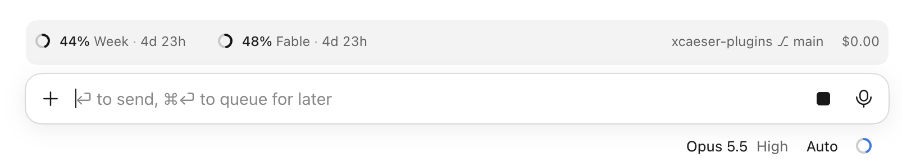

# xcaeser plugins

Two plugins for Claude Code:

- **[x](#x)**, an engineering workflow that runs on every code change.
  - **Skill:** `x:work`, which runs automatically.
  - **Commands:** `/x:think`, `/x:audit`, `/x:optimizer`, `/x:architecture`, `/x:bug-hunter`, `/x:designer`, `/x:prototype`, `/x:security`, `/x:state-machine`, `/x:review`, `/x:deprecated`.
  - **Agents:** Fable thinker, architect, optimizer, bug hunter, designer, prototyper and security; Opus auditor and state machine; Sonnet worker and reader; Haiku runner.
  - **Hooks:** a guard for checkouts shared between sessions, and deprecated-API checks for Zig, TypeScript, Rust and Go.
- **[usage-mod](#usage-mod)**, a band above the prompt: rings for your weekly and Fable usage limits, plus folder, branch, context and cost.

  

```
/plugin install x --marketplace xcaeser/xcaeser-plugins
```

```
/plugin install usage-mod --marketplace xcaeser/xcaeser-plugins
```

New versions arrive with `claude plugin update x@xcaeser`, or automatically once you enable auto-update for xcaeser in `/plugin` → Marketplaces.

## x

An engineering workflow that runs on every code change. There is no command to type: a hook set at session start routes any coding request through `x:work`, which:

1. **Thinks** at the start of a feature, and whenever two designs are plausible and the code doesn't settle it, by asking a Fable agent. Fable names what a top professional would do unasked, from which raw material, and what outside judge shows the result is right; then it gives the most elegant shape, built as if the new requirement had been there from the start, and leaves your choices open.
2. **Checks the architecture** with the Fable architect when a change adds or moves a module, boundary or core data shape, and designs on its findings; a restructure verdict comes to you first.
3. **Builds** through Sonnet workers, one per independent piece, each proving its piece by running it.
4. **Reviews** the rendered screens with the Fable designer when a change adds or reshapes UI, and applies its findings; a revamp verdict comes to you.
5. **Audits** the finished diff with an independent Opus agent when its risk calls for it (logic, security, data, APIs; not docs or tiny edits). The auditor fixes what it proves through Sonnet workers, then x commits.

It also spends fewer tokens, because workers and auditors read the files and only their conclusions reach the main thread. Comparing 40 sessions the day before installing x with 12 sessions the day after, the median request took 52% less fresh input and 61% less output, and context re-read from cache halved. Averages held level, so the saving is in typical requests, not the largest.

| Skill | Does |
|---|---|
| `x:work` | The workflow above. Runs automatically. |

The rest run only when you type them; `x:work` also runs the audit, optimizer, architect and designer itself when a change calls for them.

| Command | Does |
|---|---|
| `/x:think` | Ask Fable for a judgment on a question you name. Without it, decisions and which-option questions still reach Fable. |
| `/x:audit` | Audit a diff for bugs, quality and a simpler solution, then fix what's confirmed. |
| `/x:optimizer` | Hunt optimizations with Fable, each measured, pushing past the first win toward the floor; Sonnet agents prototype and Haiku agents measure. Read-only. `x:work` runs it when a change sits on a hot path. |
| `/x:architecture` | Have Fable audit the architecture and its elegance with a firm opinion: a verdict of restructure or refine, then an in-depth report from the code, dependency graph and git history of what to reshape, simplify or cut. Read-only. `x:work` runs it before a change that moves a boundary or core data shape. |
| `/x:bug-hunter` | Find the deepest, most annoying bug, reproduce it, and fix it and every reproduced runner-up through Sonnet workers. |
| `/x:designer` | Have Fable review the rendered UI with a firm opinion: a verdict of revamp or polish, then an in-depth report of what to redesign or improve, with screenshots, measurements and mockups. Its standards ship with the plugin, one file per lens (flow, type, craft, motion, choreography, gestures, performance, mobile web, Apple platforms, terminal, worst-case data, libraries, vocabulary), drawn from Apple's design talks and Emil Kowalski's design engineering and ranked below your `CLAUDE.md`; `x:work` also hands them to the workers that build UI. Read-only. `x:work` runs it after a change that adds or reshapes UI. |
| `/x:prototype` | Explore one UI piece as three to five genuinely different versions behind a live picker: Fable picks the directions and verifies each at full size, Sonnet workers build one variant each, and you flip through them with the number keys and keep one, which `x:work` then integrates. Nothing in production changes until you keep it. |
| `/x:security` | Have Fable attack your own app like a real attacker: map the attack surface, prove each vulnerability with a working exploit against a local instance, and fix every proven one at its root through Sonnet workers. Secrets to rotate come to you. |
| `/x:state-machine` | Map every implicit state machine (states, transitions, writers, reachable impossible states) and fix the defects it reproduces through Sonnet workers. |
| `/x:review` | Review the whole codebase at once: the architect, bug-hunter, security, optimizer, state-machine and designer agents run in parallel, report-only, and the auditor checks the existing code against your `CLAUDE.md`. Haiku runners gather the raw facts (dependency graph, tests, build, git history, scanner) once for all of them. You get one ranked list of findings and pick what gets fixed. Up to seven reviewers per run, five of them Fable. |
| `/x:deprecated` | Find every deprecated API use in the repo with the hooks' checks, then fix them all. |

Each command but `/x:review`, which runs the others' agents, is a thin wrapper around an agent that carries the whole behavior: `x:Fable-thinker` judges, `x:Fable-optimizer` optimizes, `x:Fable-bug-hunter` hunts and fixes bugs through workers, `x:Fable-architect` audits architecture and elegance, `x:Fable-designer` reviews the UI, `x:Fable-prototyper` explores UI directions through workers, `x:Fable-security` exploits and fixes vulnerabilities through workers, `x:Opus-state-machine` maps state machines and fixes through workers, `x:Opus-auditor` audits and fixes through workers, `x:Sonnet-worker` builds, including the architect's prototypes, the designer's mockups and the prototyper's variants, `x:Sonnet-reader` reads the slices of code the reviewers fan out and returns evidence for them to judge, and `x:Haiku-runner` runs the commands, searches and scans the others only need to read. They need access to the Fable, Opus, Sonnet and Haiku models.

The auditor checks the work against your `CLAUDE.md`, so the rules you write there are the bar.

Other sessions may share your checkout, so a hook blocks git commands that would take, discard or sweep in another session's work: `stash`, `reset`, `clean`, restoring the whole tree, and adding or committing everything.

Models write deprecated APIs from memory, and builds let them through, so hooks check the code Claude just wrote in Zig, TypeScript, Rust and Go with the project's own toolchain and flag each old call with the note that names its replacement:

| Language | Asks | Per edit |
|---|---|---|
| Zig | The installed std's `Deprecated` doc comments | ~50 ms |
| TypeScript 7 | The project's compiler, for its deprecation suggestions | 70–300 ms |
| Rust | `cargo check`, for its `deprecated` lint | ~0.1 s once the crate is built |
| Go | `gopls check`, for its `deprecated` analyzer | ~0.2 s |

Each hook runs only for its own file type, uses the project's own version (its mise pin or `node_modules`), and stays silent where the toolchain is missing. The TypeScript, Rust and Go hooks run on [bun](https://bun.sh).

## usage-mod

A band above the prompt: rings for your weekly and Fable usage limits, plus folder, branch, context and cost. Each ring fills as you use the limit and shows the time left until it resets.

## License

[MIT](LICENSE)
